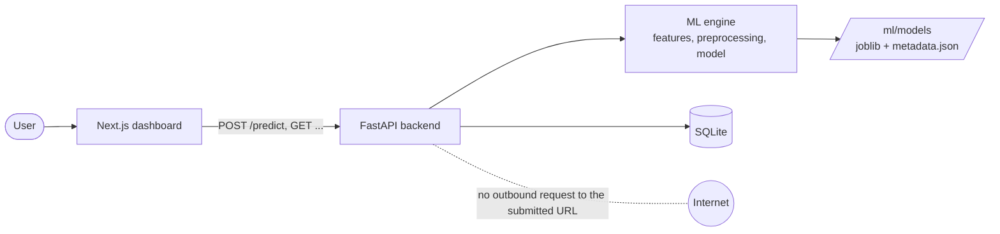
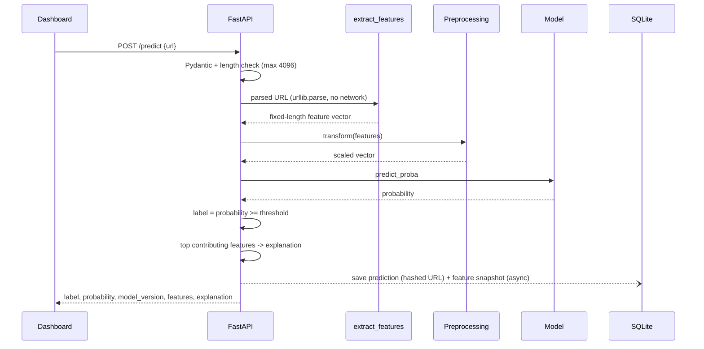
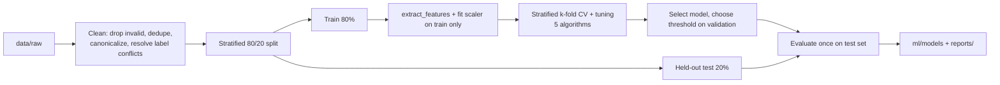
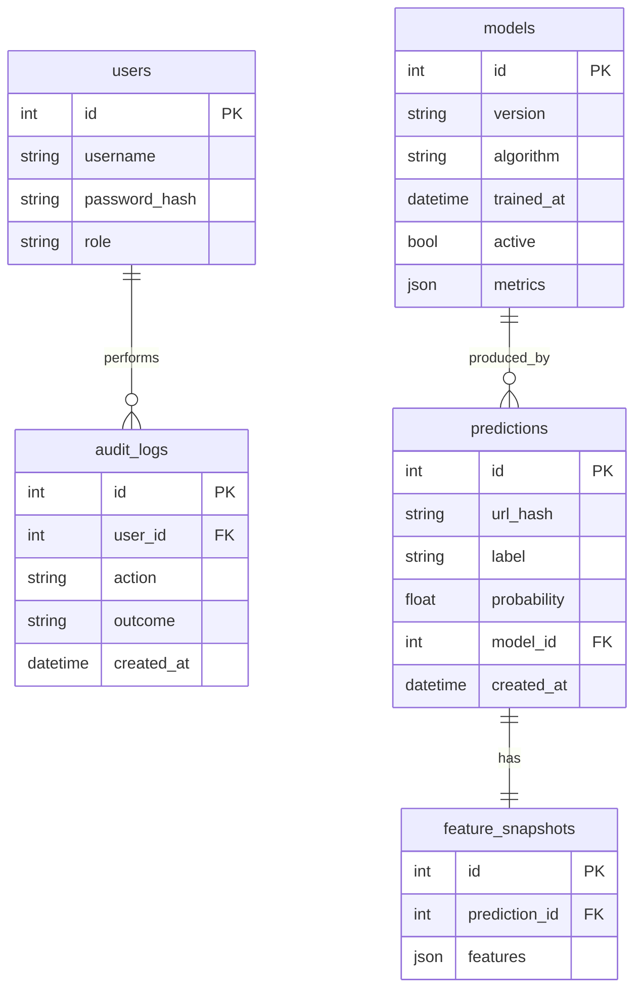

# Architecture: Phishing Website Detection Using URL Lexical Analysis

Source of truth: `docs/reference/Phishing_Detection_Report_VTU_Format.pdf` and `docs/reference/Phishing_Detection_Project_Synopsis.pdf` (Chapters 3-5). Choices made on top of the report are listed in [Decisions](#12-decisions-and-open-questions).

## 1. Overview

The system classifies a URL as **Legitimate** or **Phishing** using only the URL string. It extracts about 30 lexical and structural features, runs them through a trained scikit-learn/XGBoost model, and returns a probability with a short feature-based explanation. It never fetches the URL, so it works offline after training and is independent of any external service.

## 2. Goals and non-goals

**Goals**
- URL-only features, so there is no train/inference mismatch.
- One feature-extraction function shared by training and prediction.
- Fair comparison of five algorithms: Logistic Regression, Decision Tree, Random Forest, SVM (RBF), XGBoost.
- Reproducible experiments (fixed seed, documented data) and an end-to-end app (API + dashboard).
- Every reported metric is measured. None is assumed.

**Non-goals (future work)**
- Page crawling, HTML/JS analysis, screenshots, DNS/WHOIS lookups.
- Deep-learning models (CNN, URLNet), browser extension, drift monitoring, adversarial testing.
- Detecting phishing pages hosted on compromised legitimate domains (the URL alone carries no signal).

## 3. System context



Everything runs on the local machine. The dotted line is a hard constraint: no code path issues a network call to the submitted URL's domain.

## 4. Layers and components

| Layer | Location | Responsibility |
|---|---|---|
| Frontend | `frontend/` | Next.js, React, TypeScript, Tailwind. Pages: Detector, Result, History, Model Information, Metrics. Client-side validation before the request. |
| Backend | `backend/` | FastAPI + Uvicorn. Routes, Pydantic request/response schemas, auth for admin routes, DB access through the ORM, audit logging. Loads model and metadata once at startup. |
| ML engine | `ml/` | `features.py` (`extract_features(url)`, the single source of truth), `preprocessing.py`, `train.py`, `evaluate.py`, `predict.py`. |
| Artifacts | `ml/models/` | `phishing_model.joblib` (model + fitted preprocessing) and `metadata.json`, kept apart from source so a retrained model can be swapped in without a code change. |
| Data | `data/raw/`, `data/processed/` | Raw `URL dataset.csv` (columns `url`, `type`; see `docs/dataset/README.md`) and the cleaned, split output. |
| Reports | `reports/figures/`, `reports/metrics/` | Confusion matrices, ROC/PR curves, comparison tables generated by evaluation. |
| Tests | `tests/` | `test_features.py`, `test_api.py`, `test_model.py`, plus security and performance tests. |

The ML engine applies **feature extractor, then preprocessing, then model**, in that fixed order. Training and inference share the same code, so consistency is structural rather than by convention.

## 5. Prediction data flow



The threshold is not fixed at 0.5. It is chosen from the precision/recall/F1 curve on validation data (roughly 0.1-0.9), never from the test set, and stored in `metadata.json`.

## 6. Feature extraction

- One pure, deterministic function: `extract_features(url) -> fixed-schema vector`. The same URL always gives the same vector.
- Uses only Python's standard library (`urllib.parse`). No DNS and no HTTP.
- About 30 features in six groups, which are also the groups used in the ablation study: length, character counts, host structure, query structure, entropy, suspicious keywords. The full schema is in the report's Table 3.2. It will be recorded in `docs/design/feature-schema.md`.
- Source-dataset columns that cannot be derived from the URL string (for example, external links or form presence) are dropped before training.

## 7. Training pipeline



| Algorithm | Tuned hyperparameters | Scaling |
|---|---|---|
| Logistic Regression | `C` | StandardScaler |
| Decision Tree | `max_depth`, `min_samples_leaf` | none |
| Random Forest | `n_estimators`, `max_depth`, `min_samples_leaf`, `max_features` | none |
| SVM (RBF) | `C`, `gamma` | StandardScaler |
| XGBoost | `n_estimators`, `max_depth`, `learning_rate`, `subsample` | none |

- Metrics: accuracy, precision, recall, F1, specificity, false-negative rate, ROC-AUC, PR-AUC. FNR gets particular attention because a missed phishing URL is the costly error.
- If two models are close on F1 and ROC-AUC, pick the more interpretable one.
- Feature ablation: remove the six groups progressively and measure the change.
- Model, fitted preprocessing, and metadata (algorithm, feature schema version, threshold, training date, hyperparameters, metrics) are saved together with joblib.

## 8. Data model

SQLite through SQLAlchemy. All access goes through the ORM (parameterized queries).



Raw URLs are not stored, only a hash. The column sets above are a starting point and are not fixed by the report (see section 12).

## 9. API

| Endpoint | Access | Purpose |
|---|---|---|
| `POST /predict` | public (rate-limitable) | `{url}` returns `label`, `probability`, `model_version`, `features`, `explanation`. |
| `GET /models` | public | Model info (algorithm, training date, metrics). |
| `GET /predictions` | public | Prediction history. |
| `GET /metrics/{model_version}` | public | Confusion matrix, ROC/PR data, comparison table. |
| Training / model activation | **authenticated admin only** | Never part of the public prediction flow. Audited. |

## 10. Security design

- Every URL is untrusted text, never a location to visit. The prediction path contains no HTTP client.
- Reject malformed or oversized input (max 4096 chars) before parsing. Pydantic validates the body.
- ORM-only DB access, with no string-built SQL.
- Admin endpoints require a valid session or token. Training runs and model activations are written to `audit_logs` with actor, timestamp, and outcome.
- Errors must not leak implementation details. Tests cover SQL-injection and XSS-like strings, oversized/malformed input, unauthorized admin access, and path traversal in any file handling.

## 11. Testing

Four levels: feature-extractor unit tests, integration across frontend/backend/model, ML pipeline tests (feature column count and order, model loads, known legit/phishing sample classified correctly), and security/performance tests. Tools: pytest and FastAPI `TestClient`. Latency and memory figures are measured and reported, not estimated.

## 12. Decisions and open questions

**Decided**
- SQLite via SQLAlchemy (the report allows PostgreSQL or SQLite). It has no setup, is fully local, and can move to PostgreSQL later.
- Project scaffolded directly in the repo root, with the report's four top-level directories plus `data/`, `reports/`, and `docs/`.

**Open**
- Dataset provenance: `data/raw/URL dataset.csv` (URL + label only, 450,176 rows) is in use, see `docs/dataset/README.md`. Source recorded (DOI 10.17632/vfszbj9b36.1, Kaitholikkal and B, 2024). License: CC BY 4.0, so attribute the authors in the report. The report text still names UCI/PhiUSIIL.
- Admin auth mechanism: session cookie or bearer token. The report only says "valid session or token".
- Whether the single `users` table is needed if the app has just one admin.
- Final assignment of each feature to its ablation group, since a few (ratios, longest-token features) don't map obviously to one group.
- Report inconsistencies to fix before submission: it refers to "MCA" in places but is submitted for a PG Diploma in Big Data Analytics, and Section 1.5 points to "Chapter 7" for future work, which is actually Chapter 8.

## 13. Directory map

```
phising-detection/
├── frontend/            Next.js dashboard
├── backend/             FastAPI app, routes, schemas
├── ml/
│   ├── features.py      extract_features(url): single source of truth
│   ├── preprocessing.py
│   ├── train.py
│   ├── evaluate.py
│   ├── predict.py
│   └── models/          phishing_model.joblib, metadata.json
├── data/
│   ├── raw/
│   └── processed/
├── tests/               test_features.py, test_api.py, test_model.py
├── reports/
│   ├── figures/
│   └── metrics/
└── docs/
    ├── architecture.md
    ├── reference/       original report + synopsis PDFs
    ├── design/          feature schema, API, database details
    ├── adr/             architecture decision records
    ├── testing/         test plans and results
    └── dataset/         dataset documentation (Table 3.1 items)
```

Only `docs/` has content so far. The `.py` files above are planned, not yet created.
