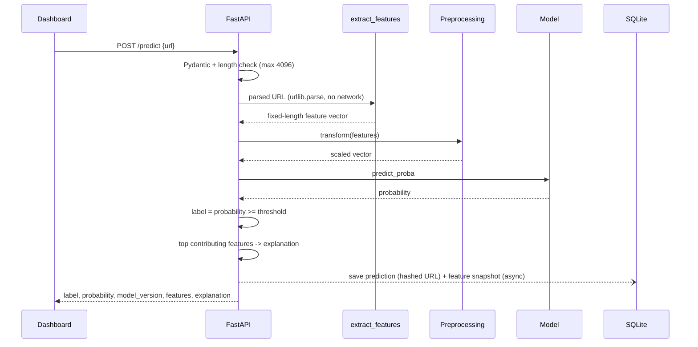
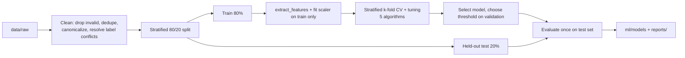
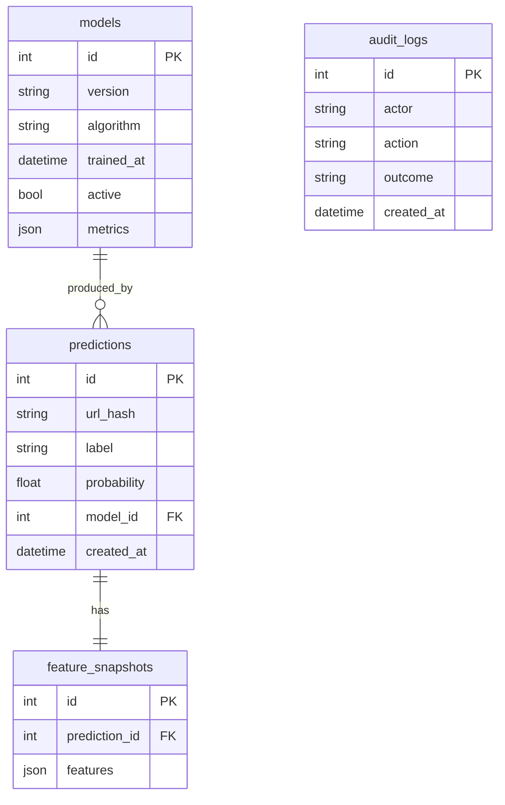

# Architecture: Phishing Website Detection Using URL Lexical Analysis

> **Status:** see [PROGRESS.md](PROGRESS.md) for what is built. Results quoted below come from `reports/metrics/`.

Source of truth: `docs/reference/Phishing_Detection_Report_VTU_Format.pdf` and `docs/reference/Phishing_Detection_Project_Synopsis.pdf` (Chapters 3-5). Choices made on top of the report are listed in [Decisions](#12-decisions-and-open-questions).

## 1. Overview

The system classifies a URL as **Legitimate** or **Phishing** using only the URL string. It extracts about 30 lexical and structural features, runs them through a trained scikit-learn/XGBoost model, and returns a probability with a short feature-based explanation. It never fetches the URL, so it works offline after training and is independent of any external service.

## 2. Goals and non-goals

**Goals**
- URL-only features, so there is no train/inference mismatch.
- One feature-extraction function shared by training and prediction.
- Fair comparison of five algorithms: Logistic Regression, Decision Tree, Random Forest, SVM (RBF), XGBoost.
- Reproducible experiments (fixed seed, documented data) and an end-to-end app (API + dashboard).
- Every reported metric is measured. None is assumed.

**Non-goals (future work)**
- Page crawling, HTML/JS analysis, screenshots, DNS/WHOIS lookups.
- Deep-learning models (CNN, URLNet), browser extension, drift monitoring, adversarial testing.
- Detecting phishing pages hosted on compromised legitimate domains (the URL alone carries no signal).

## 3. System context


Everything runs on the local machine. The dotted line is a hard constraint: no code path issues a network call to the submitted URL's domain.

## 4. Layers and components

| Layer | Location | Responsibility |
|---|---|---|---|
| Frontend | `frontend/` | Next.js, React, TypeScript, Tailwind. Pages: Detector, Result, History, Model Information, Metrics. Client-side validation before the request. |
| Backend | `backend/` | FastAPI + Uvicorn. Routes, Pydantic request/response schemas, auth for admin routes, DB access through the ORM, audit logging. Loads model and metadata once at startup. |
| ML engine | `ml/` | `features.py` (`extract_features(url)`, the single source of truth), `preprocessing.py`, `train.py`, `evaluate.py`, `predict.py`. |
| Artifacts | `ml/models/` | `phishing_model.joblib` (model + fitted preprocessing) and `metadata.json`, kept apart from source so a retrained model can be swapped in without a code change. |
| Data | `data/raw/`, `data/processed/` | Raw `URL dataset.csv` (columns `url`, `type`; see `docs/dataset/README.md`) and the cleaned, split output. |
| Reports | `reports/figures/`, `reports/metrics/` | Confusion matrices, ROC/PR curves, comparison tables generated by evaluation. |
| Tests | `tests/` | `test_features.py`, `test_api.py`, `test_model.py`, plus security and performance tests. |

The ML engine applies **feature extractor, then preprocessing, then model**, in that fixed order. Training and inference share the same code, so consistency is structural rather than by convention.

## 5. Prediction data flow



The threshold is not fixed at 0.5. It is chosen from the precision/recall/F1 curve on validation data (roughly 0.1-0.9), never from the test set, and stored in `metadata.json`.

## 6. Feature extraction

- One pure, deterministic function: `extract_features(url) -> fixed-schema vector`. The same URL always gives the same vector.
- Uses only Python's standard library (`urllib.parse`). No DNS and no HTTP.
- Features are computed on a **normalized URL**: scheme forced to `http://`, leading `www.` removed, lone trailing `/` removed. In the training data 100% of legitimate URLs are `https` and 99.8% start with `www.` (phishing: 6.4% and 8.1%), so these signals let a model separate the classes without learning anything about phishing. Details in `docs/design/feature-schema.md`.
- About 30 features in six groups, which are also the groups used in the ablation study: length, character counts, host structure, query structure, entropy, suspicious keywords. The full schema is in the report's Table 3.2 and `docs/design/feature-schema.md` (final group assignment: length 4, char_count 8, host 7, query_path 7, entropy 2, keyword 2).
- Source-dataset columns that cannot be derived from the URL string (for example, external links or form presence) are dropped before training.

## 7. Training pipeline



| Algorithm | Tuned hyperparameters | Scaling |
|---|---|---|---|
| Logistic Regression | `C` | StandardScaler |
| Decision Tree | `max_depth`, `min_samples_leaf` | none |
| Random Forest | `n_estimators`, `max_depth`, `min_samples_leaf`, `max_features` | none |
| SVM (RBF) | `C`, `gamma` | StandardScaler |
| XGBoost | `n_estimators`, `max_depth`, `learning_rate`, `subsample` | none |

- Metrics: accuracy, precision, recall, F1, specificity, false-negative rate, ROC-AUC, PR-AUC. FNR gets particular attention because a missed phishing URL is the costly error.
- If two models are close on F1 and ROC-AUC, pick the more interpretable one.
- Imbalance is handled with class weights (`class_weight="balanced"`, `scale_pos_weight` for XGBoost), not resampling.
- **SVM (RBF) is tuned and fitted on a stratified 50,000-row subsample** of the training set (it is O(n^2) to O(n^3)); the other four use all 350,141 training rows. Probabilities come from `CalibratedClassifierCV` (sigmoid). The comparison table must disclose this.
- **Random Forest used 4 random-search iterations, the others 8** (time budget). Disclose this too.
- Model selection: best CV F1; among models within 0.002 F1, prefer the more interpretable one (DT, LR, RF, XGB, SVM order). ROC-AUC and PR-AUC are reported but are not part of the rule.
- **Threshold** is chosen on out-of-fold training predictions (0.10 to 0.90, step 0.01), never on the test set. Final rule: maximum F1 (selected threshold 0.48). The first rule (max F1 subject to FNR <= 5%, giving 0.14) was set before any test result and replaced after test and sanity-set results showed it hurt precision badly. The change is recorded in `metadata.json` (`threshold_history`) and must be disclosed in the report.
- Feature ablation: remove the six groups one at a time and cumulatively (most important first), retraining with fixed hyperparameters; measured on the test split (`reports/metrics/ablation.csv`).
- Model, fitted preprocessing, and metadata (algorithm, feature schema version, threshold, training date, hyperparameters, metrics) are saved together with joblib.

## 8. Data model

SQLite through SQLAlchemy. All access goes through the ORM (parameterized queries). **Four entities, no `users` table**: admin access is a single static bearer token from the `ADMIN_TOKEN` environment variable, so `audit_logs.actor` is a label string. *(Planned; the database is not built yet.)*



Raw URLs are not stored, only an HMAC-SHA256 of the canonicalized URL keyed by `URL_HASH_KEY`, so hashes cannot be reversed by dictionary lookup. The column sets are a starting point and are not fixed by the report.

## 9. API

| Endpoint | Access | Purpose | State |
|---|---|---|---|
| `POST /predict` | public (rate-limitable) | `{url}` returns `label`, `probability`, `model_version`, `features`, `explanation`. | built |
| `GET /models` | public | Model info (algorithm, training date, metrics). | built |
| `GET /predictions` | public | Prediction history. | planned |
| `GET /metrics/{model_version}` | public | Confusion matrix, ROC/PR data, comparison table. | partly built (`GET /metrics`, no version path) |
| Training / model activation | **authenticated admin only** | Never part of the public prediction flow. Audited. | planned |

`GET /health` (built) reports whether the model loaded.

## 10. Security design

- Every URL is untrusted text, never a location to visit. The prediction path contains no HTTP client.
- Reject malformed or oversized input (max 4096 chars) before parsing. Pydantic validates the body.
- ORM-only DB access, with no string-built SQL.
- Admin endpoints require a valid session or token. Training runs and model activations are written to `audit_logs` with actor, timestamp, and outcome.
- Errors must not leak implementation details. Tests cover SQL-injection and XSS-like strings, oversized/malformed input, unauthorized admin access, and path traversal in any file handling.

## 11. Testing

Four levels: feature-extractor unit tests, integration across frontend/backend/model, ML pipeline tests (feature column count and order, model loads, known legit/phishing sample classified correctly), and security/performance tests. Tools: pytest and FastAPI `TestClient`. Latency and memory figures are measured and reported, not estimated.

## 12. Decisions and open questions

**Decided**
- SQLite via SQLAlchemy (the report allows PostgreSQL or SQLite). No setup, fully local, can move to PostgreSQL later.
- Project scaffolded directly in the repo root, with the report's four top-level directories plus `data/`, `reports/`, and `docs/`.
- Python 3.12 venv; versions pinned in `requirements.txt`.
- Admin auth: one static bearer token (`ADMIN_TOKEN`), compared with `secrets.compare_digest`. No `users` table.
- Cleaning drops artefacts, keeps real signals, and dedupes on a canonical form before the split (see `docs/dataset/README.md`).
- Feature extraction normalizes scheme, `www.` and a bare trailing slash (section 6). This is a deliberate loss of the http/https signal because it is a pure dataset artefact here.
- Final feature-to-group assignment (section 6) and the SVM subsample / RF iteration caps (section 7).
- Explanation: a heuristic, not SHAP. For each feature the backend averages (a) the probability drop when that feature alone is reset to the legitimate-class median and (b) the rise when only that feature is set to its real value on an all-median row. Top 8 shown plus per-group sums. Label it as a heuristic in the UI and report.
- Threshold rule and its history (section 7).
- Backend and ML first, frontend last (the dashboard was built early; `backend/` currently has `main.py` and `service.py` only).

**Open**
- **Generalization (blocking for a trustworthy demo).** On the held-out split the selected Random Forest scores F1 0.831, recall 0.827, precision 0.835. On 40 hand-made, real, well-known legitimate URLs (`tests/data/sanity_urls.json`, measured by `python -m ml.sanity_check`) it flags 10 as phishing (25%); it catches 19 of 20 synthetic phishing URLs. The legitimate class in the single-source dataset is narrow, so other shortcuts probably remain. Options: add a second legitimate source (for example the Tranco list) and a second phishing feed, rebuild the split and retrain; or keep the dataset and document the limitation.
- Report inconsistencies to fix before submission: it refers to "MCA" in places but is submitted for a PG Diploma in Big Data Analytics, and Section 1.5 points to "Chapter 7" for future work, which is actually Chapter 8. The dataset citation (DOI 10.17632/vfszbj9b36.1, CC BY 4.0) must replace the UCI/PhiUSIIL text.
- Same-seed reproducibility of `ml.train` has not been re-verified (a full run takes about 1 hour).
- `ml/predict.py` from the plan was not created; `backend/service.py` contains the prediction and explanation logic. Decide whether to keep it there or extract it.

## 13. Directory map

```
phising-detection/
├── frontend/            Next.js dashboard (detector page built; History, Model Info, Metrics pages not yet)
├── backend/
│   ├── main.py          FastAPI app: /health, /predict, /models, /metrics, CORS
│   └── service.py       model loading, prediction, heuristic explanation
├── ml/
│   ├── data_prep.py     Phase 1: cleaning + stratified split
│   ├── features.py      extract_features(url) and normalize_url: single source of truth
│   ├── preprocessing.py pipelines and search spaces
│   ├── train.py         tuning, selection, threshold, freeze (--resume, --rethreshold)
│   ├── evaluate.py      test metrics, figures, ablation
│   ├── sanity_check.py  hand-made real-world smoke check
│   └── models/          phishing_model.joblib (git-ignored), candidate_*.joblib, metadata.json
├── data/
│   ├── raw/             URL dataset.csv (git-ignored)
│   └── processed/       train/test parquet, feature caches, cleaning report (git-ignored)
├── tests/               test_data_prep, test_features, test_train, test_model, test_api; data/sanity_urls.json
├── reports/
│   ├── figures/         confusion matrices, ROC, PR, threshold sweep, ablation
│   └── metrics/         cv_results, test_metrics, test_comparison, ablation, threshold_sweep, chosen_threshold, sanity_check
└── docs/
    ├── architecture.md
    ├── PROGRESS.md      task checklist
    ├── reference/       original report + synopsis PDFs
    ├── design/          feature-schema.md (api.md, database.md still to write)
    ├── adr/             architecture decision records (empty)
    ├── testing/         test plans and results (empty)
    └── dataset/         dataset documentation (Table 3.1 items)
```
